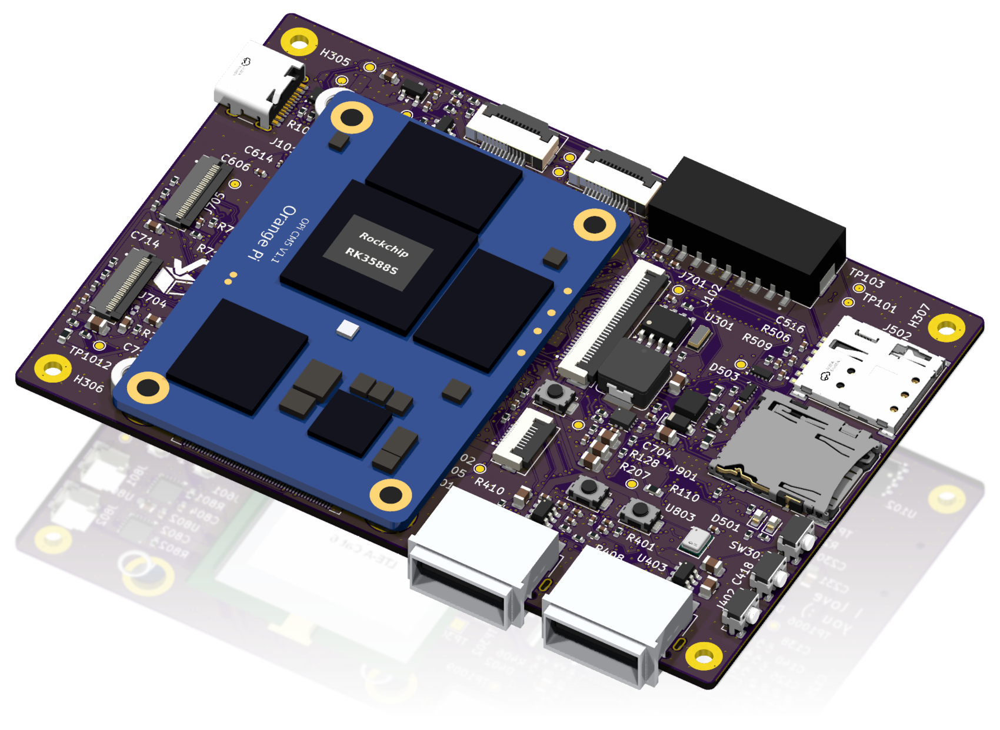
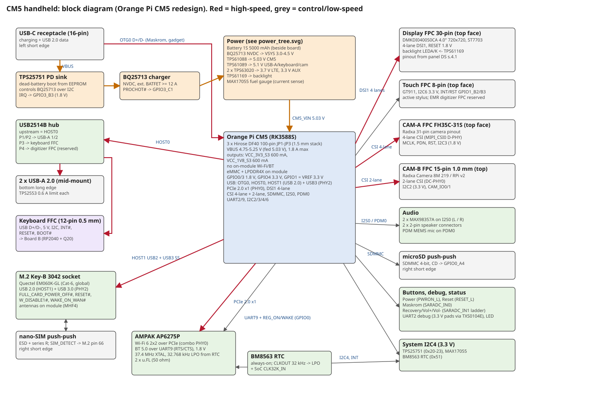
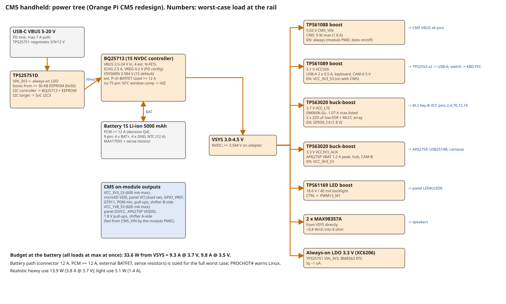
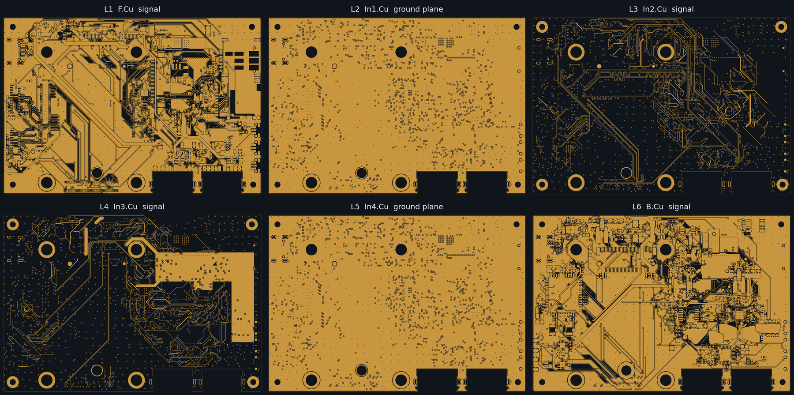
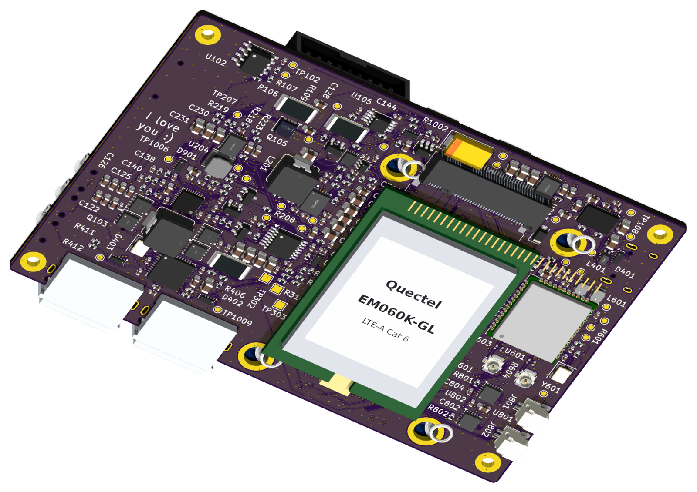
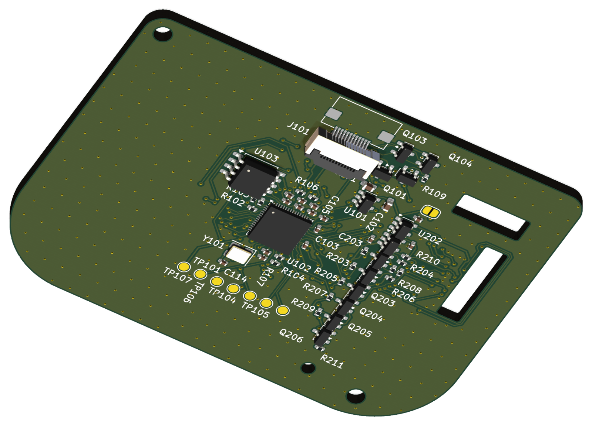
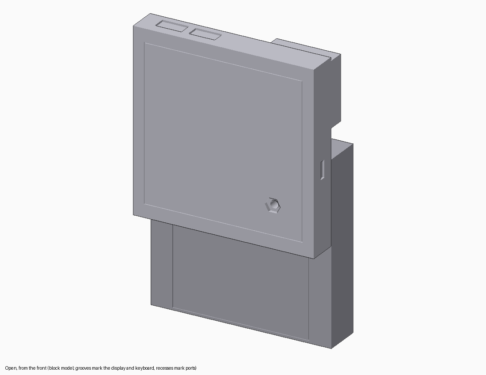
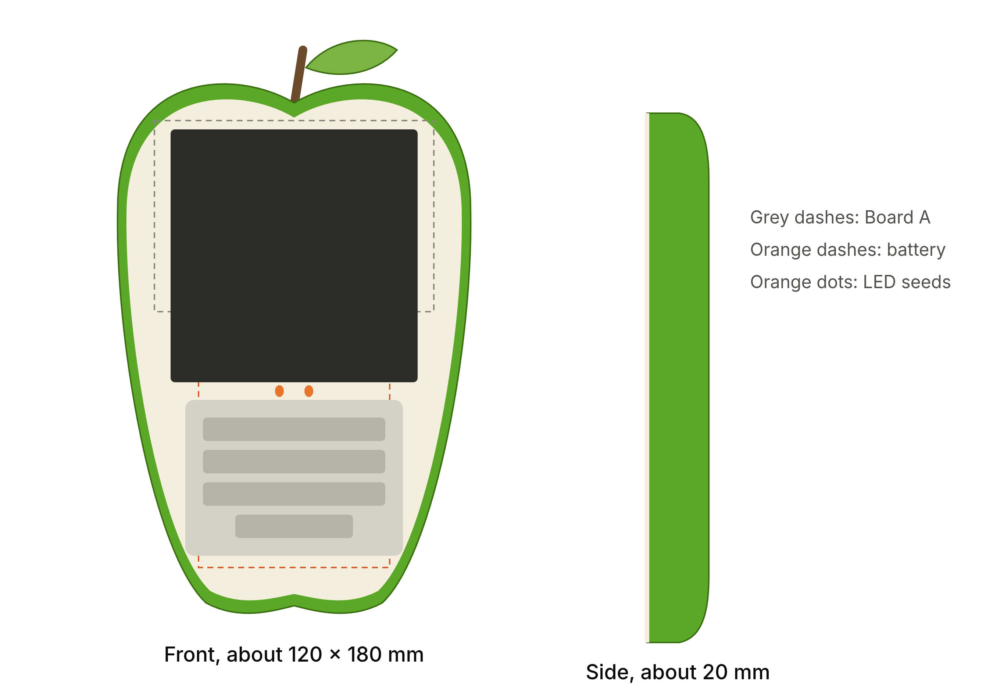
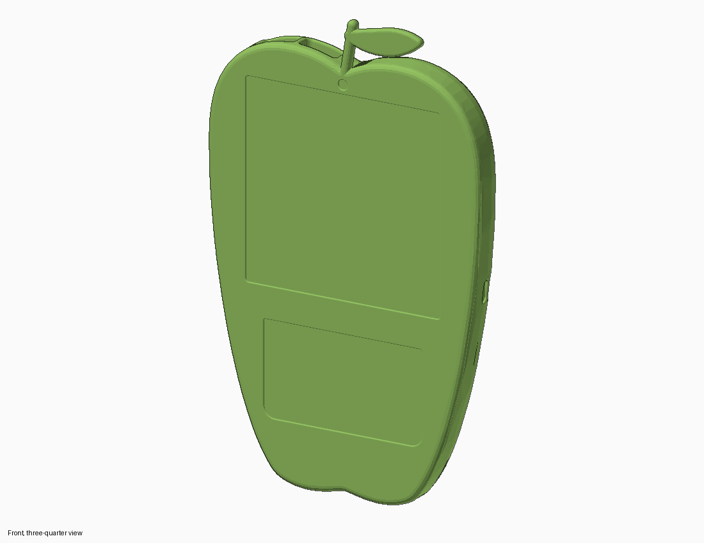
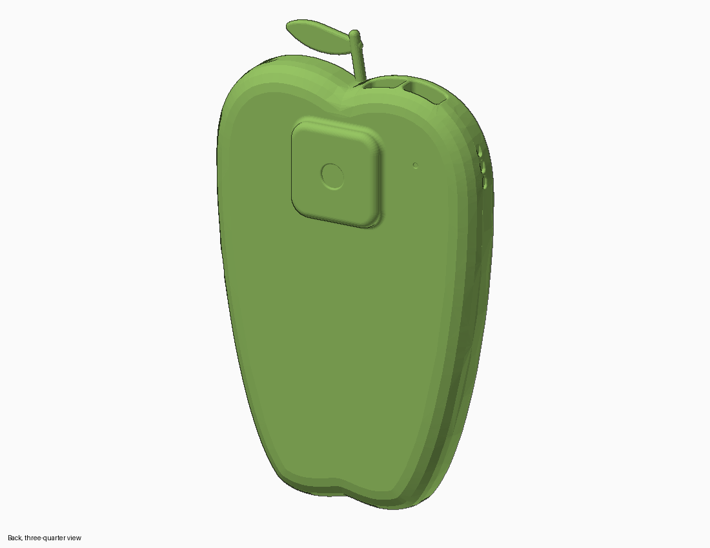

# PocketZen
A love letter to the classic PDA, but reimagined.

Desktop and phone in one. A clean, Y2K-inspired design that sits comfortably in your hand. Fully open source, top to bottom. What more could you ask for?
Meet PocketZen.

  

> **Status, 24 November 2026.** Both boards are being made at JLCPCB, and the compute module has arrived. Nothing
> has been powered on yet, so every number on this page is a design value or the result of a check on the design
> files. None of them is a measurement.

## The device

PocketZen is a pocket computer in the spirit of the classic PDA. A square 4-inch screen sits above a thumb keyboard,
and it runs full desktop Linux on an eight-core Rockchip RK3588S, with LTE, Wi-Fi 6, two cameras and a 5000 mAh
battery.

Two custom boards make up the electronics. **Board A** is a 6-layer carrier for an Orange Pi CM5 compute module and
holds everything except the keyboard. **Board B** sits under a BlackBerry Q20 keyboard and connects it to Board A
over USB.

| | |
|---|---|
| **Compute** | Orange Pi CM5: Rockchip RK3588S (4 x Cortex-A76 + 4 x Cortex-A55), 16 GB LPDDR4X, 32 GB eMMC |
| **Display** | 4.0" 720 x 720 IPS panel (DisplayModule DMKDI0400S0CA, ST7703), 4-lane MIPI DSI, capacitive touch |
| **Keyboard** | BlackBerry Q20 keyboard on Board B (RP2040), USB 2.0 to Board A |
| **Wireless** | Wi-Fi 6 2x2 + Bluetooth 5 (AMPAK AP6275P, PCIe 2.0 + UART); LTE Cat-6 (Quectel EM060K-GL, M.2, USB 3.0); nano-SIM |
| **Cameras** | rear: 4-lane MIPI CSI; front: 2-lane MIPI CSI |
| **Audio** | two I2S class-D amplifiers (MAX98357A) for stereo speakers, PDM MEMS microphone |
| **Ports** | USB-C (USB PD sink up to 12 V, charging and USB 2.0 data), 2 x USB-A behind a USB 2.0 hub, microSD |
| **Power** | 1S Li-ion 5000 mAh; buck-boost charger (BQ25713), fuel gauge (MAX17055); battery path sized for 12 A |
| **Board A** | 95 x 65 mm, 6 layers, 1.2 mm, impedance-controlled; 432 footprints (379 parts placed by machine), 9,637 track segments, 1,841 vias |
| **Board B** | 74 x 53.1 mm, 2 layers, 2.0 mm; 68 parts |

## How it fits together

The compute module plugs into Board A through three 100-pin board-to-board connectors (Hirose DF40). The red lines
in the diagram are the high-speed links:

- DSI to the display
- two CSI links to the cameras
- PCIe to the Wi-Fi module
- USB 3.0 to the LTE modem
- USB 2.0 to the hub, the keyboard and the USB-C port

**Power.** A USB-C PD controller (TPS25751) negotiates 5, 9 or 12 V and drives a narrow-VDC buck-boost charger. The
controller reads its configuration from an EEPROM, so it can start from a flat battery. The system rail (VSYS,
3.0-4.5 V) feeds:

- two boost converters: 5.03 V for the compute module, and 5.1 V for USB, the keyboard and a camera
- two buck-boost converters: 3.7 V for the LTE modem, and 3.3 V for Wi-Fi, the hub and the cameras
- the backlight driver and the audio amplifiers

If every load drew its maximum at once, the battery would supply 33.6 W, which is 9.8 A at 3.5 V. The battery
connector, protection circuit, battery FET and sense resistors are all sized for 12 A. Heavy everyday use is
estimated at about 13.9 W.

## Designed in code

The schematics, footprints, placement and routing are produced by about 17,800 lines of Python and C in
[`gen/`](gen/) and [`tools/`](tools/); none of it is drawn by hand. Every change can be rebuilt from scratch, read as
a diff and checked again on each build.

A full routing run of Board A ([`gen/route_a.py`](gen/route_a.py)) takes about six hours. In order, it:

1. lays down the power pours
2. routes the differential pairs as coupled lines with their impedance geometry ([`gen/route_pairs.py`](gen/route_pairs.py))
3. tunes pair lengths with 45-degree bumps while the board around them is still empty ([`gen/route_tune.py`](gen/route_tune.py))
4. routes the power trunks and fans out every ground pad
5. routes everything else with a negotiated-congestion (PathFinder) grid router whose core is written in C ([`gen/groute.c`](gen/groute.c))
6. fills the ground pours

[`docs/BUILDING.md`](docs/BUILDING.md) explains how to run each step.

## Signal integrity on a thin 6-layer board

Layers 2 and 5 are solid ground, so each of the four signal layers has a ground plane next to it. Trace widths and
gaps come from JLCPCB's impedance calculator for its JLC06121H-3313A stack-up (Polar Si9000 models). On the outer
layers, the ground pour stays 0.30 mm away from every controlled trace, so the microstrips match the calculation.

| Class | Target | Outer layers, width / gap | Inner layers, width / gap | Used for |
|---|---|---|---|---|
| MIPI100 | 100 ohm differential | 0.110 / 0.155 mm | 0.100 / 0.200 mm | display and camera lanes, PCIe reference clocks |
| USB90 | 90 ohm differential | 0.120 / 0.110 mm | 0.100 / 0.110 mm | USB 2.0, USB 3.0 to the modem |
| PCIE85 | 85 ohm differential | 0.130 / 0.100 mm | 0.110 / 0.100 mm | PCIe to the Wi-Fi module |
| SE50 | 50 ohm single-ended | 0.155 mm | 0.125 mm | Wi-Fi antenna feeds, microSD |

**Length matching:**

- **Within pairs:** the two traces of 28 of the 31 differential pairs match to 0.05 mm or better. The other three
  are short stubs, each explained in the decision log.
- **Display:** the four lanes are 55.08-55.22 mm long, against a 55.12 mm clock.
- **Cameras: not yet within tolerance.** Two of the rear camera's four lanes are 1.8-2.8 mm (12-20 ps) shorter than
  its clock. The front camera's two lanes are 2.8-2.9 mm (20 ps) longer than its clock. The allowance is ±1.0 mm.

Both cameras will be tested at full lane rate during bring-up ([length report](docs/opi/length_report.md)).

## Checks before manufacture

KiCad's design-rule check reports 0 errors and 0 unconnected nets. The schematic and the board match exactly, and
the schematic passes its electrical-rule check. On top of that:

- **Rak's review before every submission.** Rak went through the design and the files before each set of Gerbers
  went to the manufacturer. This review found that the part outlines on the silkscreen were 0.12 mm wide, under
  JLCPCB's 0.15 mm minimum. That width is KiCad's default, and no automated check here caught it. The review also
  shaped the order package: a Gerber job file now tells the fab each layer's function and order, and the impedance
  drawing and table are kept apart from the board layers.
- **JLCPCB's engineering review.** Before production, each order's Gerber, drill, BOM and placement files went
  through review at JLCPCB:
  - their CAM engineers checked the fabrication files
  - their SMT engineers checked parts, land patterns and placement

  Over three submissions of Board A they raised three problems, all fixed (see the table below). The files now in
  production passed both reviews, and so did Board B's. This checks that the boards can be made. It is not a review
  of the circuit design, and an independent design review is still open in [`REVIEW.md`](REVIEW.md).
- **Gerber-level connectivity** ([`tools/gerber_check.py`](tools/gerber_check.py)). KiCad treats copper that only
  touches as connected, but a board house's CAM software does not. This check reads the exported Gerbers back as
  geometry and measures every track and via joint the way the fab will see it.
- **Comparison with the production files** ([`tools/jlc_prod_check/`](tools/jlc_prod_check/)). JLCPCB's CAM output
  was compared with this design layer by layer (geometric XOR) before the order was confirmed. The comparison also
  covered track widths, drill counts and any copper they added.
- **Footprint audit** ([`docs/footprint_audit.md`](docs/footprint_audit.md)). Each of the 24 footprints made for the
  project was checked against its datasheet drawing, down to which edge or centre each dimension is measured from.
- **Parts.** Every BOM line was checked against JLCPCB's live catalogue (part number, manufacturer number, stock).
  [`tools/datasheets.py`](tools/datasheets.py) confirms that every non-trivial part has its datasheet in
  [`datasheets/`](datasheets/README.md).

## What went wrong, and what changed

| Date | What happened | Why | What changed |
|---|---|---|---|
| 2026-10-30 | JLCPCB's CAM stopped the first order: some track ends only touched | KiCad's checks count copper that only touches as connected | 395 duplicate tracks removed, 153 joints bridged at full width (D110); the Gerber-level check added (D116) |
| 2026-10-31 | Found in review: the outer ground pour ran 0.09 mm from controlled traces | a pour that close turns a microstrip into a coplanar line, which lowers its impedance | 0.30 mm keep-out around every controlled trace (D112) |
| 2026-11-06 | JLCPCB's assembly review: the Wi-Fi module's 50 pads sat 0.56 mm too far in | a datasheet dimension between pad centres had been read as between pad edges | footprint corrected and the board routed again (D114); every other footprint audited for the same mistake (D115) |
| 2026-11-10 | The display maker's drawing put pin 1 of both panel cables at the other end | the pin direction had been assumed and was marked UNVERIFIED | connectors mirrored and the whole board routed again (D118) |
| 2026-11-15 | JLCPCB: copper too close to the edge rails for V-cut separation | 0.25 mm from the edge is fine for routed edges but too little for V-cut | rails joined by mouse-bite tabs instead; 0.4 mm clearance for the next revision (D122) |
| 2026-11-18 | Rak's review: silkscreen part outlines 0.12 mm wide, under JLCPCB's 0.15 mm minimum | KiCad's library default, which no automated check here looks at | 0.15 mm minimum and a Gerber job file for the next revision (D123) |

## Every decision is written down

[`docs/DECISIONS.md`](docs/DECISIONS.md) holds 22 answered design questions and 123 design decisions. Each one gives
the choice, the alternatives, the reason and the sources. Anything not confirmed from a primary source (a datasheet,
a drawing or a measurement) is marked **UNVERIFIED** until it is.

  
  

Left: Board A, bottom side (LTE modem, Wi-Fi module, power stages). Right: Board B, the keyboard board.

## The enclosure

None of these designs changed the boards; each shell was fitted around them as they are. Whatever the design, the
shell will be 3D printed, with test prints at home first and the final shell from a printing service (E6).

  
  
  
  

Left to right: the swivel block model (open), Rak's half-apple sketch, half-apple block model v1 (front) and v2 (back).

The designs, in order:

1. **Plain slab (checkpoints 1-3, October 2026).** The boards were placed for this layout: the display above the
   keyboard in one shell of about 95 x 150 x 15 mm. It was a working assumption and was never designed as a shell.
2. **Swivel (9 November, E1-E5).** This was Rak's choice, modelled on the Motorola FLIPOUT. It had two halves of
   about 98 x 90 mm, and the screen half turned 90 degrees about a pivot near one corner to uncover the keyboard.
   Because the panel is square, the picture loses nothing when it rotates.
   - The rear camera sat on the back of the screen half, so it worked only with the device open. When closed, it
     rested in a curved channel in the keyboard half.
   - There was a block model and a printable mock-up of each half: 98.5 x 152 mm open, 98.5 x 98.5 mm closed, and
     37.1 mm thick.
3. **Half-apple (19 November, E7, E8).** This is Rak's design, drawn to scale: a slab shaped like an apple cut in
   half, about 120 x 180 x 20 mm.
   - **Shape:** the cut face is the front, with the display above the keyboard. The skin forms the rim and the
     rounded back, with a stem and leaf on top.
   - **Why it replaced the swivel:** there is no pivot, it is about half as thick, the battery and keyboard cables
     are short, and the skin leaves room for antennas and speakers.
   - **Ports:** USB-A behind rubber lids; USB-C through a short extension cable to a socket in the skin; SIM and
     microSD under the back plate.
4. **Half-apple block model v1 (20 November).** Every edge is rounded, and there is a printable mock-up. The rear
   camera sits in a 7 mm bump in the middle of the back, and the front camera is above the screen. Rak printed it,
   and v2 came out of that print.
5. **Half-apple block model v2 (21 November, E11, E12), the current design.**
   - The rear camera moved high on the back, out of the grip, in a 5.4 mm bump.
   - The front camera moved between the screen and the keys.
   - The battery moved against the back wall.
   - The keyboard cable is now modelled.

Decisions, fit checks and the model files for every design are in [`docs/enclosure/`](docs/enclosure/ENCLOSURE.md).

## Repository

| Path | Contents |
|---|---|
| [`gen/`](gen/) | generators: schematics, footprints, placement, routing (`route_*.py`, `groute.c`), length tuning |
| [`hw/`](hw/) | the KiCad 10 projects for Board A (`board_a/`) and Board B (`board_b/`), produced by `gen/` |
| [`fab/`](fab/) | the manufacturing packages: Gerbers, drill files, BOM, placement, stack-up, impedance drawing, `ORDER.md` |
| [`tools/`](tools/) | checks and reports: Gerber connectivity, production-file comparison, BOM, impedance, datasheets, images, enclosure models |
| [`docs/`](docs/README.md) | design reports, decision log, bring-up plan, status, enclosure; index in [`docs/README.md`](docs/README.md) |
| [`datasheets/`](datasheets/README.md) | the datasheets, drawings and reference designs the design rests on, with an index |
| [`software/`](software/) | Linux device tree for Orange Pi's images (written, not yet tested on hardware) |
| [`research/`](research/) | extracted text and image crops from the sources, JLCPCB capability and impedance data |
| [`REVIEW.md`](REVIEW.md) | the pre-manufacture review: open points, assumptions, what an experienced engineer should check |

## Roadmap

- [x] Requirements, architecture, pin and power budgets
- [x] Schematics, placement, routing and manufacturing files for both boards
- [x] Board A moved to the Orange Pi CM5 when the original module (Radxa CM5) could not be bought
- [x] Both boards ordered and in production at JLCPCB; Board A is 6 layers, impedance-controlled and machine-assembled
- [x] Bring-up plan with the expected value at every test point ([`docs/bringup/BRINGUP.md`](docs/bringup/BRINGUP.md))
- [x] Enclosure form chosen; printable block model v2
- [ ] Bring-up: power rails, first boot, display, cameras, Wi-Fi, LTE
- [ ] USB PD configuration and programming the PD controller's EEPROM
- [ ] Display init sequence from the panel maker's data in the device tree
- [ ] Measurements: converter efficiency, battery life, thermals, signal quality on the high-speed links
- [ ] Linux device tree and drivers validated on the hardware
- [ ] The final printed shell
- [ ] Rev B, with what bring-up teaches
- [ ] A paper on the whole project

## Who did what

PocketZen is designed by Rak Pozareny together with Claude, an AI model made by Anthropic, used through Claude Code.

**Rak**

- defined the device: what it is for, what it has to do, and the requirements the design is built to
- made the project's decisions: answered the 22 design questions in the decision log (stylus, display, modem,
  Wi-Fi, battery and its current, sourcing, licences and more) and reviewed the detailed decisions at each checkpoint
- sourced the modules and parts, and deals with the manufacturers and suppliers
- reviewed the design and its Gerber files before every submission to the manufacturer
- designed the enclosure (the half-apple form, and where the ports and cameras go), and prints and tests the mock-ups
- will assemble, bring up and test the hardware

**Claude**

- wrote the code in `gen/` and `tools/` that generates and checks the boards, and produced the schematics,
  footprints, placement and routing with it
- worked out most of the detailed circuit and layout decisions (D1-D123 in the decision log), each put to Rak
  for review
- built the enclosure's CAD models from Rak's design
- wrote most of the documentation, including the bring-up plan

Every commit in this repository is Rak's, so Claude does not appear among its authors. This section is where
Claude's work is credited.

## Licences

Everything here is under the MIT licence ([`LICENSE`](LICENSE)), with two exceptions:

- **Board B** (`hw/board_b/`, `fab/board_b/`, and the scripts that build it: `gen/build_b.py`, `gen/pcb_b.py`,
  `gen/route_b.py`) is released under the CERN Open Hardware Licence v1.2
  ([`hw/board_b/LICENSE.md`](hw/board_b/LICENSE.md)). Its keyboard connector placement and outline come from
  Solder Party's [BBQ20KBD](https://github.com/solderparty/bbq20kbd_hw). The recommended firmware,
  [i2c_puppet](https://github.com/solderparty/i2c_puppet), is MIT-licensed.
- **[`datasheets/`](datasheets/README.md)** holds other companies' documents (datasheets, drawings, reference
  schematics). They are copyright their makers, kept here for reference and not covered by the MIT licence. The
  BBQ20KBD files there are CERN-OHL v1.2, with the licence beside them.

## Acknowledgements

- Solder Party's BBQ20KBD and i2c_puppet, which Board B and its firmware build on
- Orange Pi, Radxa and Khadas, whose published schematics and drawings served as reference designs
- the open-source KiCad project

The renders use the parts' 3D models from the **JLCEDA / EasyEDA Official Library** ([lceda.cn](https://lceda.cn/),
[easyeda.com](https://easyeda.com)), fitted onto this design's footprints by `tools/media.py`. The compute module,
the LTE card, the USB-A ports and the battery connector are modelled from their drawings and a photo of the module.
