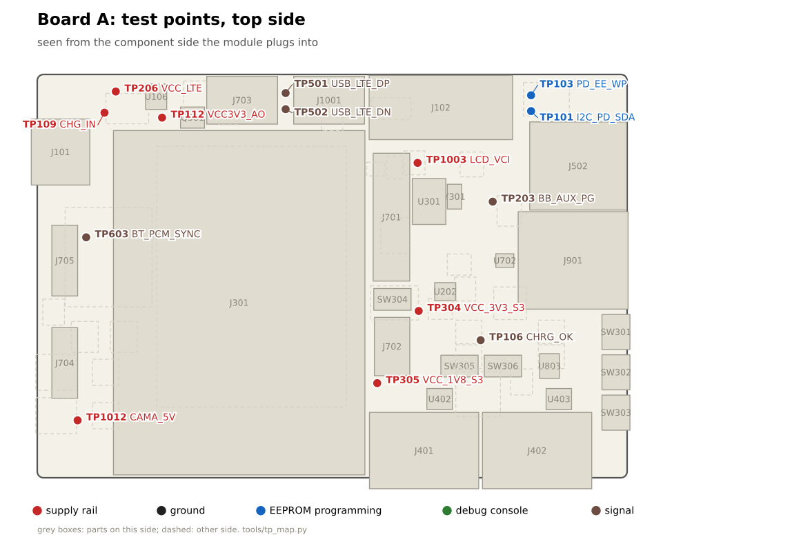
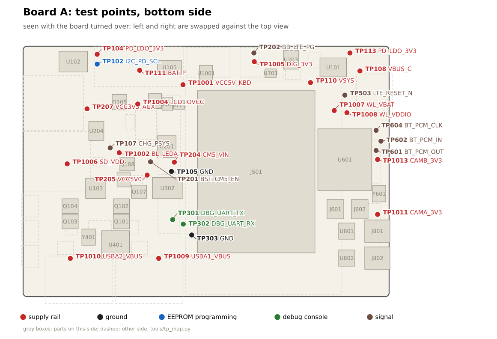
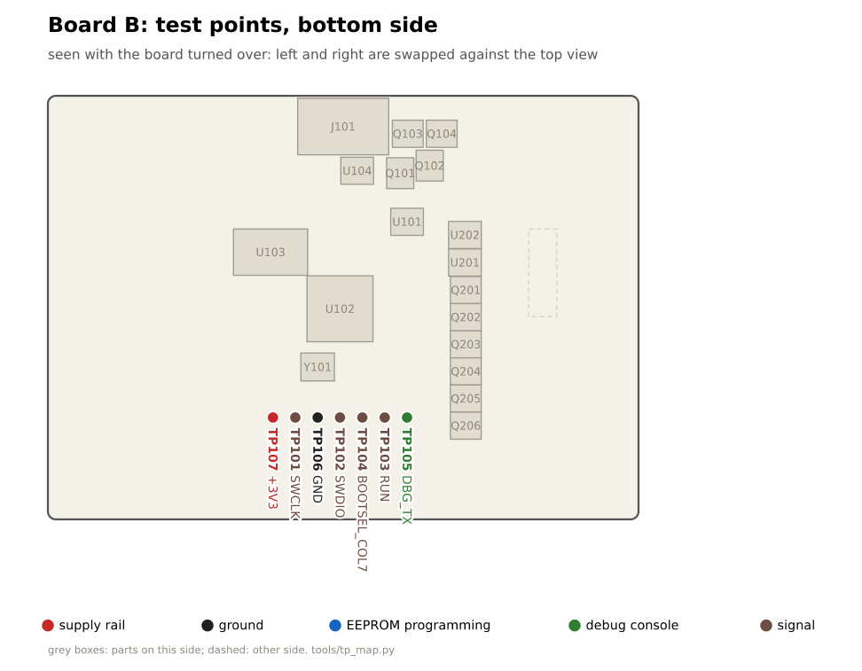

# Bring-up plan: Board A (carrier) and Board B (keyboard)

Written 2026-11-19, while both boards are in production. Nothing here has been measured yet: every expected value
comes from the design (`gen/`, the schematics) and the datasheets in `datasheets/board_a/`, and the column "Measured"
in the record sheets is for the bench. Where a value is an estimate rather than a datasheet figure, it says so.

The order is: look, measure resistance, power the carrier without the module, then fit the module, then add one
function at a time. Each step has a pass condition. If a step fails, stop there: the later steps assume the earlier
ones passed.

## Contents

1. [What to have on the bench](#1-what-to-have-on-the-bench)
2. [Test-point maps](#2-test-point-maps)
3. [Rules for every step](#3-rules-for-every-step)
4. [How the power comes up (what to expect, and why)](#4-how-the-power-comes-up)
5. [Stage 0: inspection, no power](#stage-0-inspection-no-power)
6. [Stage 1: carrier on the battery input, no module](#stage-1-carrier-on-the-battery-input-no-module)
7. [Stage 2 (optional): the module's 3.3 V supplied from outside](#stage-2-optional-the-modules-33-v-supplied-from-outside)
8. [Stage 3: module fitted, first power-on, debug console](#stage-3-module-fitted-first-power-on-debug-console)
9. [Stage 4: this board's device tree, then each function](#stage-4-this-boards-device-tree-then-each-function)
10. [Stage 5: PD controller EEPROM](#stage-5-pd-controller-eeprom)
11. [Stage 6: USB-C power and charging](#stage-6-usb-c-power-and-charging)
12. [Stage 7: on the battery](#stage-7-on-the-battery)
13. [Board B](#board-b)
14. [If something is wrong](#if-something-is-wrong)
15. [Record sheets](#record-sheets)

## 1. What to have on the bench

| Item | For | Notes |
|---|---|---|
| Bench supply, 0-5 V, at least 3 A, with a current limit | everything until Stage 6 | the board is powered at its **battery connector J102**, not at USB-C (section 4 says why) |
| Battery lead (shopping list item 11): Molex 505570-0901 housing with its pre-crimped leads | the supply into J102 | pins 1-4 BAT+ (red), 5-8 BAT- (black), pin 9 NTC: **leave pin 9 unconnected** on the bench supply. Join the four reds and the four blacks before the supply |
| Multimeter | every step | |
| 3.3 V USB-serial adapter at 1 500 000 baud (item 19: CH341T in UART mode, CP2102N or FT232R) | debug console, Stage 3 | its own 3.3 V / 5 V pin stays unconnected |
| microSD card, 8 GB or more, with Orange Pi's Debian 12 or Ubuntu 22.04 image for the CM5 (Linux 6.1) | first boot | the image `software/README.md` is written for |
| Heatsink and thermal pad for the RK3588S (item 16) | from Stage 3 | the SoC must not run without one for more than a short boot |
| Magnifier or microscope, fine tweezers, isopropyl alcohol, Kapton tape, ESD mat or wrist strap | Stage 0 and fitting parts | |
| A 47-51 ohm resistor, 1 W or more | load test, Stage 1 | about 100 mA at 5 V |
| 10 k, 33 k and 3.9 k resistors | NTC stand-ins, Stage 6 | |
| Oscilloscope (optional) | ripple, LTE supply dips, the 32.768 kHz clock | |
| CH341T in I2C mode (item 18) | EEPROM, Stage 5 | |
| Speakers, display, cameras, LTE card and antennas, Wi-Fi antennas, FFC, Board B | Stage 4 onward, one at a time | `docs/off_board_parts.md` |

Two copies of Board A are made. Doing each step on both and comparing the readings is the quickest way to spot a
fault: a reading that differs a lot between the two boards points at the board, not at the design.

## 2. Test-point maps

Generated from the routed boards by `tools/tp_map.py`. The bottom views are drawn as you see them with the board
turned over, so left and right are swapped against the top view.

**Board A, top** (the side the module plugs into):

**Board A, bottom:**

**Board B, bottom:**

Ground for the meter: TP105 or TP303 (bottom), or any of the four M2 mounting-hole pads (H305-H308).

## 3. Rules for every step

1. **Power off before plugging or unplugging anything:** the module, the LTE card, an FFC, a camera cable, the
   display. Most of these connectors carry supply rails on pins next to signal pins.
2. **Set the current limit before connecting the supply,** with the output off. Turn it on with the meter already on
   the rail you are about to read.
3. **Write every reading in the record sheet,** including the supply current, on both boards.
4. **Stop and disconnect** if the supply goes into current limit when it should not, if a rail is outside its range,
   if any part is hot to the touch, or if you smell anything. Find the cause before you power it again.
5. **The Orange Pi CM5 is fitted once.** Hirose rates the DF40 pair for 30 mating cycles. Everything that can be
   checked without the module is checked first (Stages 0-2).

## 4. How the power comes up

`docs/opi/power_tree.svg` is the full tree. What matters for bring-up:

- **USB-C does not power the board until the PD controller's EEPROM is programmed.** The TPS25751's ADCIN1 / ADCIN2
  straps decode to 7 / 0. TI's Table 8-6 (SLVSH93A) calls that **SafeMode**: "The device does not enable the sink
  path. USB PD is disabled until configuration is loaded." The configuration comes from the EEPROM (U102), which is
  blank on delivery. So Stages 1-4 run from the battery connector J102, and USB-C power is Stage 6.
- **On the battery input alone, the charger connects the battery to the system.** BQ25713 datasheet 9.3.1: with only
  a battery present, above VVBAT_UVLOZ (2.55 V typical, 2.75 V max), the BATFET (Q105) turns on and connects
  it to VSYS.
- **The charger will not charge until it is configured.** ChargeCurrent() is 0 A at power-on (BQ25713 9.6.3); the
  TPS25751 writes the charge settings from its configuration (2.5 A, 4.2 V planned).
- **Without the module**, these are the only regulators that run:
  - XC6206, always-on 3.3 V (VCC3V3_AO);
  - TPS61088 boost, the module's 5.03 V supply (CM5_VIN). Its EN is pulled up to VSYS, so it runs whenever VSYS is
    there. TP201 pulls it low to stop it, but the TPS61088 has no load disconnect in TI's datasheet, so CM5_VIN
    then sits at about VSYS minus a diode drop, not at 0 V.
- **The module turns on the rest.**
  - The 5 V boost (TPS61089, VCC5V0) is enabled by EN_5V, which is pulled up to the module's VCC_1V8_S3.
  - The AUX 3.3 V buck-boost (TPS63020, VCC3V3_AUX) follows the module's VCC_3V3_S3.
  - The LTE supply (TPS63020, VCC_LTE) stays off until software enables it (100 k pull-down on its EN).
  - The display supply (TPS22919, LCD_VCI) and the backlight (PWM pulled down) are off until software turns them on.

### Expected supply voltages

Ranges are worst case from the datasheet reference tolerance and 1 % resistors.

| Rail | Test point | Nominal | Range | From |
|---|---|---|---|---|
| VCC3V3_AO | TP112 (top) | 3.30 V | 3.23-3.37 V | XC6206P332, +-2 % |
| CM5_VIN (module supply) | TP204 (bottom) | 5.03 V (PWM); about 5.07 V at light load (PFM reference 1.212 V) | 4.88-5.19 V | TPS61088 VREF 1.186-1.222 V, 178 k / 56 k. The module accepts 4.75-5.25 V (Orange Pi PIN definition V1.1) |
| VCC5V0 | TP205 (bottom) | 5.14 V (PWM); about 5.19 V at light load | 4.96-5.32 V | TPS61089 VREF 1.188-1.236 V, 324 k / 100 k |
| VCC3V3_AUX | TP207 (bottom) | 3.31 V | 3.22-3.40 V, up to a few % higher at light load | TPS63020 VFB 495-505 mV, 1 M / 178 k. PS/SYNC low = power-save mode, where TI allows the output to sit above the PWM value (VFB_PS) |
| VCC_LTE | TP206 (top) | 3.75 V | 3.65-3.85 V | TPS63020 in forced PWM, 1 M / 154 k. The EM060K accepts 3.135-4.4 V |
| VCC_3V3_S3, VCC_1V8_S3 | TP304, TP305 (top) | 3.3 V, 1.8 V | | made by the module |
| BL_LEDA (backlight anode) | TP1002 (bottom) | backlight off: VSYS minus a Schottky drop; on: about 18.6 V | | panel spec s.6.3: 2 x 6 LEDs, 18.6 +-0.3 V, 40 mA |

## Stage 0: inspection, no power

Both boards, before any power.

**Look** (magnifier):
- Solder bridges on the fine-pitch parts:
  - J301-J303, the module connectors (0.4 mm pitch);
  - U101 (TPS25751) and U103 (BQ25713), both QFN;
  - U201 (TPS61088), U202 (TPS61089), U203 / U204 (TPS63020);
  - U401 (USB2514B) and U601 (AP6275P).
- Pin 1 or polarity of the parts in `fab/board_a/ROTATIONS.md` (they were checked in JLCPCB's preview; this is the
  real board).
- C615, C616 and C709 empty (not fitted by design).
- SW304-SW306 fitted with their locating pins cut, sitting flat.
- The mouse-bite tab remains on the long edge: cut and file them flush with the outline, not past it (D122).
- J102 (battery), J101 (USB-C), J401 / J402 (USB-A) soldered at their shell tabs.

**Measure resistance to ground** (meter on its resistance range, black lead on GND). Large capacitors make some rails
start low and climb; that is fine. A reading that stays below about 10 ohm is a short: find it before any power.
Record each value; the two boards should read about the same.

| Rail | Test point |
|---|---|
| BAT_P | TP111 |
| VSYS | TP110 |
| VBUS_C, CHG_IN | TP108, TP109 |
| VCC3V3_AO, PD_LDO_3V3 | TP112, TP104 |
| CM5_VIN | TP204 |
| VCC5V0 | TP205 |
| VCC3V3_AUX | TP207 |
| VCC_LTE | TP206 |
| VCC_3V3_S3, VCC_1V8_S3 | TP304, TP305 |
| BL_LEDA | TP1002 |

Board B: +3V3 (TP107) to GND (TP106).

Pass: no rail stays below about 10 ohm, and the two boards agree.

## Stage 1: carrier on the battery input, no module

Nothing plugged in: no module, no LTE card, no display, no cables.

1. Bench supply set to **3.80 V, limit 100 mA**, output off. Connect the lead to J102 (reds +, blacks -, pin 9 free).
2. Output on. Read the supply current at once.
   - Expected: a few mA, up to about 20 mA. This is an estimate. The largest load should be the TPS25751, waiting
     for its configuration: TI gives 3-6 mA into VIN_3V3 in active sink mode, with an adapter. The rest are
     standby currents in the microamp range.
   - **Stop above 50 mA.**
3. Measure:

| TP | Net | Expected |
|---|---|---|
| TP111 | BAT_P | the supply voltage |
| TP110 | VSYS | the supply voltage, minus a few mV (the BATFET is on) |
| TP112 | VCC3V3_AO | 3.23-3.37 V |
| TP104, TP113 | PD_LDO_3V3 | about VCC3V3_AO (the TPS25751 switches VIN_3V3 through) |
| TP204 | CM5_VIN | 4.88-5.19 V, about 5.07 V with no load |
| TP201 | BST_CM5_EN | the supply voltage (10 k pull-up to VSYS) |
| TP205 | VCC5V0 | VSYS minus a diode drop (boost off: EN_5V has no 1.8 V to pull it up) |
| TP1012 | CAMA_5V | the same as VCC5V0 (0 ohm link) |
| TP1002 | BL_LEDA | VSYS minus a Schottky drop (backlight off) |
| TP207, TP206 | VCC3V3_AUX, VCC_LTE | 0 V (off; the TPS63020 disconnects its output when off) |
| TP304, TP305 | VCC_3V3_S3, VCC_1V8_S3 | 0 V (no module) |
| TP108, TP109, TP106 | VBUS_C, CHG_IN, CHRG_OK | 0 V (no adapter) |
| TP1001, TP1009, TP1010 | VCC5V_KBD, USBA1_VBUS, USBA2_VBUS | 0 V (port switches off) |
| TP1003, TP1004, TP1006 | LCD_VCI, LCD_IOVCC, SD_VDD | 0 V |

4. **Sweep the input:** slowly move the supply from 3.3 V to 4.2 V and back. CM5_VIN must stay inside 4.88-5.19 V
   the whole way (the battery's working range).
5. **Light load on CM5_VIN:** with the supply off, put the 47-51 ohm resistor from TP204 to TP105, then turn it on:
   about 100 mA. CM5_VIN stays inside 4.88-5.19 V. Remove the resistor afterwards. The module is the full-load test,
   in Stage 3, where the bench supply's current limit protects it.
6. After a minute, touch-test: nothing should be warm. In particular, check U201, its inductor, U106 and U101.

Pass: current below 50 mA, every row as expected, CM5_VIN in range across 3.3-4.2 V and with 100 mA.
**Do not fit the module if CM5_VIN is outside 4.75-5.25 V.** Check R205 (178 k) and R206 (56 k) first.

## Stage 2 (optional): the module's 3.3 V supplied from outside

This checks the AUX 3.3 V buck-boost and the VCC_3V3_S3 net before the module is at risk. It needs a second
supply output.

1. Board on the battery input as in Stage 1 (3.80 V; raise the limit to 300 mA).
2. Second output: **3.30 V, limit 50 mA**, + to TP304 (VCC_3V3_S3), - to TP303.
   - Do not apply 1.8 V to TP305. The debug UART's level shifter U302 (TXS0104E) needs VCCA (1.8 V side) at or
     below VCCB (3.3 V side); TI allows VCCB to come up first, not VCCA.
   - With 3.3 V alone, its OE (tied to VCCA) is low, so its outputs are off.
3. Expected:

| TP | Net | Expected |
|---|---|---|
| TP207 | VCC3V3_AUX | 3.22-3.40 V (slightly higher at light load is fine) |
| TP203 | BB_AUX_PG | high, about VCC3V3_AUX (power good) |
| TP1007 | WL_VBAT | about VCC3V3_AUX |
| TP1011, TP1013 | CAMA_3V3, CAMB_3V3 | about VCC3V3_AUX |
| TP1006 | SD_VDD | 3.30 V (0 ohm from VCC_3V3_S3) |
| TP1003 | LCD_VCI | 0 V (LCD_PWREN pulled down) |
| TP1005 | DIG_3V3 | 0 V (hub port 4 is not powered without a host) |

   - 3.3 V output current: a few mA (pull-ups and small loads only).
   - The main supply current rises by what the AUX rail feeds. The USB hub runs without a host, and the AP6275P's
     enables are left floating with no module. Record the value: expect tens of mA (estimate).
4. Turn off the 3.3 V output first, then the main supply. Remove the 3.3 V lead.

## Stage 3: module fitted, first power-on, debug console

1. Everything off. Thermal pad and heatsink on the module's RK3588S.
2. **Fit the Orange Pi CM5:**
   - JP1 / JP2 / JP3 on the module go onto J301 / J302 / J303. JP3 is the lone connector on the module's short edge,
     toward the USB-A edge of the carrier. The three connectors line up only one way.
   - Line up all three before pressing, then press straight down over each connector in turn, not on the SoC.
   - Four M2.5 screws into H301-H304, finger-tight. Length: the module's PCB thickness (about 1.6 mm) plus up to
     1.5 mm; measure it (shopping list item 15).
3. microSD with Orange Pi's image in J901.
4. **Debug console:** adapter GND to TP303 first, then the adapter's **RX to TP301** (DBG_UART_TX, the SoC's
   output) and its **TX to TP302** (DBG_UART_RX). On the PC: `picocom -b 1500000 /dev/ttyUSB0` (or
   `tio -b 1500000 ...`), 8N1, no flow control. The adapter's own supply pin stays unconnected. The pads are 3.3 V:
   U302 translates the module's 1.8 V UART (D90).
5. Bench supply **3.90 V, limit 1.0 A**, output on.
   - The console should print within a second or two: Rockchip's loader first, then U-Boot.
   - If the supply sits in current limit with nothing on the console, turn off and go back to Stage 1's readings.
   - If the console prints, raise the limit to **3.0 A**. The module may brown out and restart at 1 A during boot;
     that does no harm.
   - Booting draws roughly 0.5-1.5 A at 3.9 V (estimate). Use short, thick leads: 0.2 V lost in the leads is 0.2 V
     less on VSYS.
6. **If nothing happens** (console silent, current under about 50 mA after 5 s): press POWER (SW301, right edge) for
   about 1 s. Whether the module starts by itself when its supply appears, or waits for PWRON_L, is not stated in
   Orange Pi's documents we have: **UNVERIFIED**, note which it is.
7. While it boots, measure:

| TP | Net | Expected |
|---|---|---|
| TP204 | CM5_VIN | 4.88-5.19 V under load |
| TP304 | VCC_3V3_S3 | 3.3 V |
| TP305 | VCC_1V8_S3 | 1.8 V |
| TP207, TP203 | VCC3V3_AUX, BB_AUX_PG | 3.22-3.40 V, high |
| TP205 | VCC5V0 | 4.96-5.32 V (EN_5V high: R207, 100 k to VCC_1V8_S3, and GPIO0_D5's default pull-up) |
| TP1004 | LCD_IOVCC | 1.8 V |
| TP1008, TP1007 | WL_VDDIO, WL_VBAT | 1.8 V, about 3.31 V |
| TP1006 | SD_VDD | 3.3 V |
| TP206 | VCC_LTE | 0 V (until software turns it on) |

8. **Which medium it boots from:** the module has its own eMMC, which may or may not carry an image from the factory.
   Which of eMMC and microSD comes first was not checked here: read it from the console.
9. Log in with the default user from Orange Pi's CM5 user manual.

Pass: the console shows the boot to a login prompt, and every rail above is in range.

Stock image, stock device tree: this tree is written for Orange Pi's base board, where some pins have other jobs.
Use it only to install this board's tree (Stage 4). Don't plug in anything else until then.

## Stage 4: this board's device tree, then each function

**Install the tree:** `software/README.md`, "Build and install", step 3. Copy
`software/build/rk3588s-orangepi-cm5-handheld.dtb` to `/boot/dtb/rockchip/` and set `fdtfile=` in
`/boot/orangepiEnv.txt`, then reboot with the console attached. If it does not boot, put the old `fdtfile` line back
from another computer. The six extra drivers (`software/kernel/cm5-handheld.config`) can come later: without them
the board boots, and those parts just have no driver.

Then one function at a time, **powering off before connecting each part**. Bus numbers below are the device tree's
names; `i2cdetect -l` gives the Linux number of each.

| # | Function | Connect (power off) | Check | Pass |
|---|---|---|---|---|
| 4.1 | System I2C | - | `i2cdetect -y <i2c4>` | 0x20 (TPS25751), 0x36 (MAX17055: address **UNVERIFIED**, from the Linux binding example), 0x51 (RTC; shows `UU` once its driver binds) |
| 4.2 | RTC | - | `hwclock -w`, then `hwclock -r` after a reboot; scope or counter on U301 pin 7 (CLKOUT) | time kept while the battery input stays connected (no coin cell: the RTC runs from VCC3V3_AO). 32.768 kHz at CLKOUT; note the error in ppm (the crystal is 7 pF, the BM8563 is characterised at 8 pF) |
| 4.3 | VSYS monitor | - | SARADC channel 2: raw / 4095 x 1.8 V x 3.004 (1 M / 499 k divider) | within about 2 % of TP110. The 12-bit SARADC and 1.8 V reference are assumed from the RK3588 family: check the driver's scale file |
| 4.4 | Buttons | - | `evtest`: POWER (SW301), Vol+ (SW302), Vol- (SW303) and RECOVERY (SW306) on the ADC keys. RESET (SW304) restarts the SoC | each press seen once |
| 4.5 | Status LED | - | D302 | heartbeat |
| 4.6 | USB hub | - | `lsusb`, `lsusb -t` | the USB2514B hub on HOST0 |
| 4.7 | USB-A | a USB stick, then a mouse, in J401 / J402 | TP1009 / TP1010 | port VBUS 4.96-5.32 V; the device enumerates. The port switch (TPS2553) limits each port to 0.61-0.74 A, by design |
| 4.8 | microSD | (already in) | card detect: remove and reinsert a second card when not booting from it | `dmesg` sees both events |
| 4.9 | Fuel gauge | - | `/sys/class/power_supply/*/voltage_now` (needs the MAX17055 driver) | the battery input voltage. The charge level means nothing on a bench supply |
| 4.10 | Wi-Fi / BT | antennas on J601 / J602 | `lspci` (BCM43752 on PCIe), `dmesg \| grep -i bcmdhd`, `nmcli dev wifi list`, `bluetoothctl scan on` | networks and devices found; firmware loads (the AP6275P firmware is expected in Orange Pi's images, UNVERIFIED) |
| 4.11 | Speakers | 8 ohm speakers on J801 / J802 | `aplay -l`, `speaker-test -c 2 -t wav` on the "speakers" card | left and right correct, no distortion at moderate volume. Watch the supply current |
| 4.12 | Microphone | - | `arecord` on the "microphone" card | speech recorded clearly |
| 4.13 | Keyboard | Board B via the FFC (see [Board B](#board-b)) | TP1001 VCC5V_KBD, then `lsusb` | 4.96-5.32 V once the hub powers port 3; the keyboard enumerates |
| 4.14 | Display | panel FPC in J701, touch FPC in J702 | needs the panel driver set-up (the display device-tree task, from DisplayModule's init file). TP1003 LCD_VCI 3.3 V and TP1004 LCD_IOVCC 1.8 V when on; BL_LEDA (TP1002) about 18.6 V; LED current = voltage across R703 / 5.1 ohm (204 mV = 40 mA at full duty; the PWM is capped at 90 %) | picture, no flicker; backlight current at or under 40 mA |
| 4.15 | Touch | (with the display) | `i2cdetect -y <i2c6>`, `evtest` | GT911 at 0x5D or 0x14 (the address follows INT at reset); touches tracked |
| 4.16 | Rear camera (CAM-A) | Radxa Camera 13M 214 on J704 | `v4l2-ctl --list-devices`, a raw capture | IMX214 at 0x10 and DW9714 at 0x0c on I2C3 (from the device tree). **Test at the full lane rate:** the lane-to-clock skew review item (D117, D119) |
| 4.17 | Front camera (CAM-B) | Radxa Camera 8M 219 via the 31-to-15-pin cable on J705 | as above | IMX219 at 0x10 on the software I2C bus |
| 4.18 | LTE | EM060K-GL in J501 (bottom), M2 x 3 screw into H501; nano-SIM in J502; LTE antennas on the card before it registers on a network | VCC_LTE (TP206) once the driver enables it; `lsusb -t` (USB 3.0 link at 5000M); `mmcli -L`; `AT+CPIN?` | VCC_LTE 3.65-3.85 V, and with a scope never below 3.135 V during registration bursts; the modem enumerates on USB 3.0; the SIM is read |

## Stage 5: PD controller EEPROM

USB-C power and charging need the TPS25751's configuration in the M24512 EEPROM (U102). The procedure and the
configuration file are a separate task. In short (from the design and `docs/board_status.md`):

- The board runs on the battery input. The EEPROM is powered by the TPS25751's PD_LDO_3V3, not by the adapter.
- CH341T at 3.3 V: SDA to TP101 (top), SCL to TP102 (bottom), GND to TP105, and TP103 (WP) to GND while writing.
  The CH341T's supply pin stays unconnected.
- Write the image and read it back to verify. Release WP, then remove the battery input for a few seconds so the
  TPS25751 restarts and loads the configuration.

## Stage 6: USB-C power and charging

After Stage 5.

**6a: USB-C with the bench supply on the battery input.** Do it first without the module, then again with it:
1. Bench supply on J102 at 3.80 V, **pin 9 (NTC) still open**. With no NTC the charge window reads "too cold", so
   the charger does not charge: no current is pushed back into the bench supply.
2. Plug in a USB-C PD charger. Expected:
   - CHRG_OK (TP106) high, about 3.3 V;
   - VBUS_C (TP108) at the contract voltage, 5, 9 or 12 V from the configuration;
   - CHG_IN (TP109) about the same as VBUS_C;
   - VSYS now supplied by the charger: the bench supply's current drops to near zero.
3. Unplug and replug a few times; try a plain 5 V USB-C charger and a PD charger.

**6b: first charge, on the bring-up cell** (105080 cell with its protection board, 10 k B3435 NTC on pin 9, through
the Molex lead):
1. The cell part-charged (about 3.7 V). Board on the cell, module fitted, booted.
2. Plug in the PD charger.
   - The charge current is the voltage across R109 (10 mOhm, between BAT_P and the BATFET): 25 mV = 2.5 A. Or
     read it from the fuel gauge's `current_now`.
   - Expected: up to 2.5 A (the configured value). It is less if the charger or the input limit
     (2.97 A on CHG_IN, set by R114 / R115 on ILIM_HIZ) does not allow it while the system is also running.
3. Watch the cell temperature. The window cuts off at about 46 C; stop the test well before, at about 40 C. Charging
   ends at 4.2 V.

**6c: the charge window, with resistors in place of the NTC.** Bench supply off the board; use the cell, and
replace its NTC lead on pin 9 by a resistor from pin 9 to BAT-:

| Resistor on pin 9 | Equivalent | Expected |
|---|---|---|
| 10 k | 25 C | charges |
| 33 k | below 0 C (threshold 28.7 k) | does not charge |
| 3.9 k | above about 46 C (threshold 4.7 k) | does not charge |
| open | NTC missing | does not charge |

Thresholds from the design (`gen/board_a_power.py`): cold 0.738 x VNTC, hot 0.320 x VNTC.

## Stage 7: on the battery

- Full system on the bring-up cell, no bench supply: boot, run a load (`stress-ng`), watch the SoC temperature and
  the cell voltage.
- PROCHOT# (GPIO3_C1) has no consumer in the device tree yet: note whether the charger raises it under load.
- Fuel gauge: one full charge and discharge before trusting its percentage.

## Board B

Board B is powered and tested from Board A, after Board A's hub works (4.6). Board A's TPS2553 (U1001) limits the
keyboard supply to 0.61-0.74 A, which protects Board B on its first power-up.

1. Stage 0 on Board B: look (RP2040, flash, the keyboard-flex connector J101), and measure +3V3 (TP107) to GND
   (TP106).
2. Power off. Connect the FFC (contacts on opposite sides, shopping list item 13) between Board A J1001 and Board B.
   Without the keyboard flex at first.
3. Power on. Expected:
   - Board A TP1001 (VCC5V_KBD): 4.96-5.32 V once the hub powers port 3;
   - Board B TP107 (+3V3): 3.3 V (AP2112K);
   - a new USB device. With empty flash, the RP2040 drops to its USB bootloader after 0.5 s and shows up as a USB
     drive named RPI-RP2 (RP2040 datasheet 2.8).
4. Copy the i2c_puppet firmware, built for the `bbq20kbd_breakout` board, to that drive. That board file uses
   exactly Board B's pins (`docs/checkpoint2/CHECKPOINT2.md`).
5. Power off, fit the Q20 keyboard flex, power on. Check the keys, the trackpad, the backlight and the four top
   buttons. The I2C side (0x1F on I2C6) shows in `i2cdetect -y <i2c6>`.

If the USB path does not work: SWD on TP101 (SWCLK), TP102 (SWDIO), TP106 (GND), with TP103 (RUN) as reset. TP104
(BOOTSEL_COL7) held to GND during a reset forces the USB bootloader. TP105 is the RP2040's debug UART output (3.3 V).

## If something is wrong

| Symptom | Look at first |
|---|---|
| Stage 1 current limit, or above 50 mA | resistance per rail (Stage 0) to find which rail; then the warm part on that rail (touch, or a few drops of isopropyl that evaporate first on the hot part) |
| VSYS missing, BAT_P present | Q105 (BATFET) and U103; the input below 2.75 V |
| VCC3V3_AO missing | U106 |
| CM5_VIN out of range | R205 / R206, U201's soldering, the inductor |
| VCC5V0 or VCC3V3_AUX missing with the module running | EN_5V (R207, 100 k to VCC_1V8_S3); the AUX enable divider R221 / R222 from VCC_3V3_S3 |
| Console silent, current high | module seating; VCC_3V3_S3 / VCC_1V8_S3 present? |
| Console silent, current low | POWER button (Stage 3, step 6); adapter RX on TP301; baud 1 500 000 |
| Console garbage | baud rate; adapter not at 3.3 V |
| Boot loops | supply current limit or lead drop: VSYS sagging under the boot current |
| USB-C does nothing | expected until Stage 5 |

## Record sheets

Print this part. One column per board.

**Stage 0: resistance to GND**

| Rail | TP | Board A #1 | Board A #2 |
|---|---|---|---|
| BAT_P | TP111 | | |
| VSYS | TP110 | | |
| VBUS_C | TP108 | | |
| CHG_IN | TP109 | | |
| VCC3V3_AO | TP112 | | |
| PD_LDO_3V3 | TP104 | | |
| CM5_VIN | TP204 | | |
| VCC5V0 | TP205 | | |
| VCC3V3_AUX | TP207 | | |
| VCC_LTE | TP206 | | |
| VCC_3V3_S3 | TP304 | | |
| VCC_1V8_S3 | TP305 | | |
| BL_LEDA | TP1002 | | |
| Board B +3V3 | TP107 | | |

**Stage 1: battery input 3.80 V, no module**

| Reading | Expected | Board A #1 | Board A #2 |
|---|---|---|---|
| Supply current | < 50 mA (few mA to ~20 mA) | | |
| VSYS (TP110) | 3.80 V | | |
| VCC3V3_AO (TP112) | 3.23-3.37 V | | |
| PD_LDO_3V3 (TP104) | ~ VCC3V3_AO | | |
| CM5_VIN (TP204), no load | 4.88-5.19 V | | |
| CM5_VIN at 3.3 V in | 4.88-5.19 V | | |
| CM5_VIN at 4.2 V in | 4.88-5.19 V | | |
| CM5_VIN with 100 mA | 4.88-5.19 V | | |
| VCC5V0 (TP205) | VSYS - diode | | |
| BL_LEDA (TP1002) | VSYS - Schottky | | |
| VCC3V3_AUX, VCC_LTE | 0 V | | |
| Warm parts after 1 min | none | | |

**Stage 3: module fitted**

| Reading | Expected | Board A #1 | Board A #2 |
|---|---|---|---|
| Starts by itself or needs POWER | (UNVERIFIED) | | |
| Boot medium | | | |
| Supply current, booting / idle | | | |
| CM5_VIN (TP204) | 4.88-5.19 V | | |
| VCC_3V3_S3 (TP304) | 3.3 V | | |
| VCC_1V8_S3 (TP305) | 1.8 V | | |
| VCC3V3_AUX (TP207) | 3.22-3.40 V | | |
| VCC5V0 (TP205) | 4.96-5.32 V | | |
| LCD_IOVCC (TP1004) | 1.8 V | | |
| WL_VDDIO / WL_VBAT (TP1008 / TP1007) | 1.8 V / ~3.31 V | | |
| SD_VDD (TP1006) | 3.3 V | | |

**Stage 4: functions**: tick each row of the Stage 4 table, with the date and any note.
